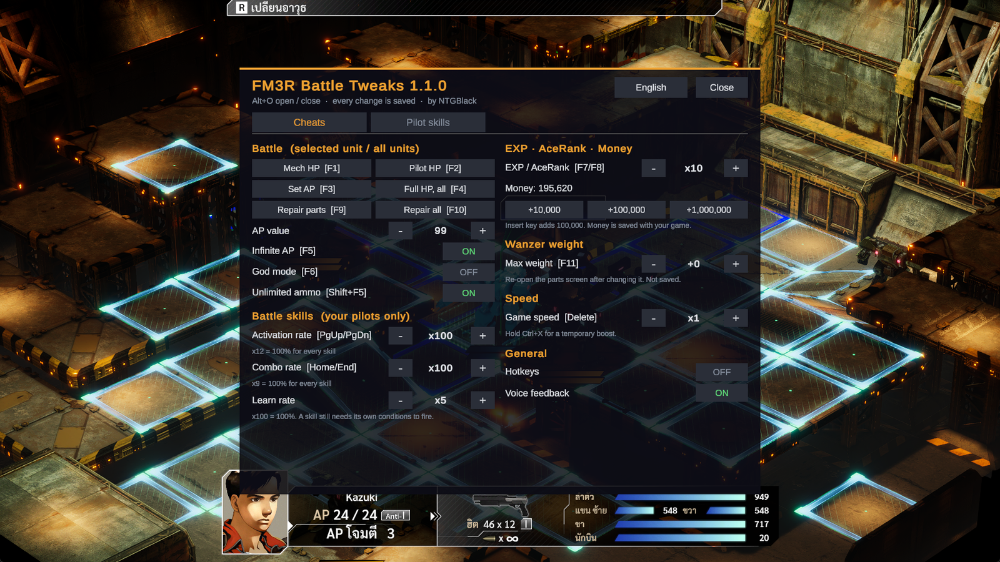

# FM3R Battle Tweaks — in-game cheat menu for Front Mission 3 Remake

**For Front Mission 3 Remake v1.1.1 (Steam) · Windows 10 / 11 64-bit · single-player only**

A BepInEx plugin that adds a cheat menu **inside the game**. Press **Alt+O**, click with the mouse, or use the hotkeys.
Menu languages: English · ไทย · 中文 · 日本語 · 한국어

## ⬇️ Download

**[Nexus Mods — FM3R Battle Tweaks](https://www.nexusmods.com/frontmission3remake/mods/8?tab=files)**
Get the **with BepInEx** file (BepInEx 6 IL2CPP is included).

## Install

1. Steam → right-click the game → **Manage → Browse local files**.
2. Extract **everything** from the archive into that folder (`winhttp.dll` must be next to `Front Mission 3 Remake.exe`).
3. Start the game — the **first start takes 1–3 minutes longer** while BepInEx prepares itself.
4. In game press **Alt+O**.

Uninstall: delete `BepInEx\plugins\FM3RBattleTweaks.dll`. To remove BepInEx too, delete `winhttp.dll`, `doorstop_config.ini`, `.doorstop_version` and the `BepInEx` and `dotnet` folders.

## Features

| Key | Feature |
|---|---|
| Alt+O | Open / close the in-game menu |
| F1 / F2 | Restore mech HP / pilot HP (selected unit) |
| F3 | Set AP (value set in the menu) |
| F4 | Restore mech + pilot HP (all units) |
| F5 | Infinite AP |
| Shift+F5 | Unlimited ammo (your units) |
| F6 | God mode |
| F9 / F10 | Repair destroyed parts (selected / all) |
| PgUp / PgDn | Battle-skill activation rate x1 – x100 (your pilots) |
| Home / End | Skill combo rate x1 – x100 |
| F7 / F8 | EXP + AceRank multiplier |
| Delete · Ctrl+X | Game speed · hold for a temporary boost |
| F11 / Shift+F11 | Max weight (Body Power) bonus |
| Insert | Add money |
| Menu | Skill learn rate · pilot battle skills editor · voice feedback |

- Enemies are not affected by skill rates or unlimited ammo. A skill still needs its own conditions (weapon, range …).
- Saved with your game: money, pilot skills, EXP and AceRank you earn. Back up your save before editing pilot skills.
- Cheats are not remembered: every game start begins with all of them off / x1. Game speed is always x1 in the main menu and while loading.
- Bug reports: attach `BepInEx\LogOutput.log` and the newest file in `BepInEx\FM3RBattleTweaks_logs` — [Discord](https://discord.gg/U4ZAwR6mfP) or the Nexus Mods Bugs tab.

## Links

🌐 [ntgblack.web.app](https://ntgblack.web.app) · 💬 [Discord](https://discord.gg/U4ZAwR6mfP) · 🧡 [Ko-fi](https://ko-fi.com/ntgblack)

Not affiliated with Square Enix, Forever Entertainment or MegaPixel Studio. BepInEx © the BepInEx team (LGPL-2.1).
