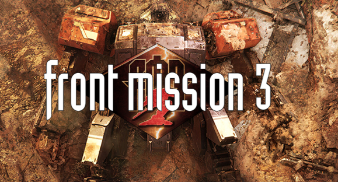

  

<h1 align="center">Front Mission 3 Remake — +10 Trainer</h1>

  
  
  

<b>English</b> · <a href="#ภาษาไทย">ภาษาไทย</a>

## Download

👉 **[Latest release](https://github.com/NTGBlack/fm3r-trainer/releases/latest)** — download the `.exe` under **Assets**.

| | |
|---|---|
| Game | Front Mission 3 Remake (Steam) |
| Windows | 10 (1903+) / 11 — 64-bit |
| Install | Nothing — single `.exe`, uses .NET Framework 4.8 built into Windows |
| Languages | English · ไทย · 中文 · 日本語 · 한국어 |

Each release is built for **one game version** — check the release name.
Release tags look like `g1.1.1-r1` = game **1.1.1**, trainer revision **1**.

## Cheats

| Hotkey | Cheat |
|---|---|
| `F1` | Restore mech HP (selected unit) |
| `F2` | Restore pilot HP (selected unit) |
| `F3` | Set AP (value set in the trainer) |
| `F4` | Restore mech + pilot HP (all units) |
| `F5` | Infinite AP |
| `F6` | God mode |
| `F9` / `F10` | Repair destroyed parts (selected / all) |
| `F7` / `F8` | EXP + AceRank multiplier up / down (1x – 100x) |
| `Delete` · hold `Ctrl+X` | Game speed 0.1x – 10x · temporary boost |
| `F11` · `Shift+F11` | Max weight (Body Power) bonus up / down |

## How to use

1. Start the game.
2. Open the trainer — the status turns **green** when connected.
3. Press the hotkeys in game, or click the buttons in the trainer window.

**“Windows protected your PC”?** The trainer is not code-signed, so SmartScreen warns on first launch. Click **More info → Run anyway**.
**Check the file:** each release lists the **SHA-256** of the `.exe`. If yours is different, do not run it.

Single-player only. Use at your own risk. Not affiliated with the game's publisher.
Help, bug reports and requests: **[Discord](https://discord.gg/U4ZAwR6mfP)**.

---

## ภาษาไทย

👉 **[ดาวน์โหลดเวอร์ชันล่าสุด](https://github.com/NTGBlack/fm3r-trainer/releases/latest)** แล้วกดไฟล์ `.exe` ในส่วน **Assets**

- ใช้กับ **Windows 10 (1903 ขึ้นไป) / 11 แบบ 64-bit** — **ไม่ต้องติดตั้งอะไร** เปิดไฟล์ได้เลย
- แต่ละ release ทำมาสำหรับ**เกมเวอร์ชันเดียว** ดูจากชื่อ เช่น `g1.1.1-r1` = เกม **1.1.1** ครั้งที่ **1**
- เปิดเกมก่อน แล้วเปิด trainer สถานะจะเป็น**สีเขียว**เมื่อเชื่อมต่อแล้ว
- ถ้าขึ้น **“Windows protected your PC”** ให้กด **More info → Run anyway** (เพราะไฟล์ยังไม่มีลายเซ็นดิจิทัล)
- ตรวจไฟล์ด้วยค่า **SHA-256** ในหน้า release ถ้าไม่ตรง **ห้ามเปิด**
- ถามวิธีใช้ แจ้งบั๊ก หรือขอ trainer ได้ที่ **[Discord](https://discord.gg/U4ZAwR6mfP)**
